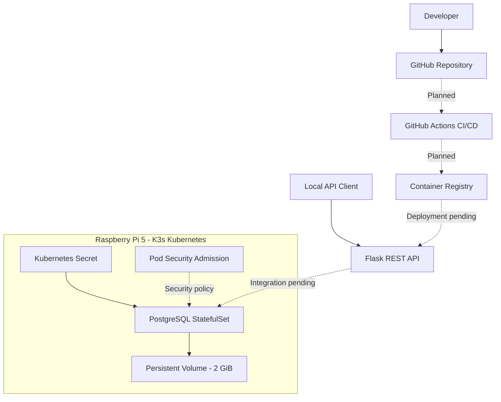

# Raspberry Pi DevSecOps Security Lab

## Securing a Cloud-Native Application: From Code to Runtime

A hands-on DevSecOps and cloud-native security project built using a Raspberry Pi 5, Kubernetes (K3s), Python Flask and PostgreSQL.

The objective is to demonstrate how to design, deploy, secure and assess a cloud-native application throughout its software development lifecycle.

Rather than simply deploying security tools, this project focuses on understanding realistic attack paths, implementing appropriate security controls, evaluating their effectiveness and reducing the potential blast radius of a compromise.

**Project status:** In progress — Kubernetes, Flask API and PostgreSQL infrastructure operational.

---

## Project Architecture

The application consists of a Python Flask REST API and a PostgreSQL database.

The API currently runs locally on the Raspberry Pi, while PostgreSQL is deployed inside Kubernetes. Database integration and containerisation are upcoming stages.



### Technology Stack

| Component | Technology |
|-----------|------------|
| Hardware | Raspberry Pi 5 - 16 GB RAM |
| Operating System | Raspberry Pi OS 64-bit, Debian 12 |
| Container Orchestration | Kubernetes - K3s |
| Kubernetes Version | v1.37.1+k3s1 |
| Container Runtime | containerd |
| Backend | Python Flask |
| Database | PostgreSQL 16 |
| Persistent Storage | K3s Local Path Provisioner |
| Version Control | Git and GitHub |
| CI/CD | GitHub Actions - planned |
| Container Security | Trivy - planned |

---

## Project Progress

### Phase 1 — Infrastructure Preparation [Completed]

- Configured Raspberry Pi 5 for development.
- Verified CPU architecture, memory and storage.
- Enabled Linux memory cgroups.
- Installed K3s Kubernetes.
- Verified Kubernetes node readiness.
- Confirmed core Kubernetes system Pods are operational.

**Challenges encountered:**

The initial K3s installation failed because the installer could not reach its release discovery endpoint. This was resolved by specifying a K3s release directly.

### Phase 2 — Kubernetes Security [Completed]

Created a dedicated namespace:

`devsecops-lab`

Configured Pod Security Admission:

- Baseline policy enforced.
- Restricted policy warnings enabled.
- Restricted policy auditing enabled.

**Security validation:**

Attempted to create a privileged container using Kubernetes server-side dry-run validation.

**Expected:** Kubernetes should reject the Pod.

**Actual:** Request rejected with `Forbidden` because it violated the Baseline Pod Security policy.

**Conclusion:** Baseline admission enforcement successfully rejected the tested privileged workload.

### Phase 3 — Flask REST API [Completed — Initial Version]

Developed a Python Flask customer management API.

Implemented endpoints:

| Method | Endpoint | Description |
|--------|----------|-------------|
| GET | / | Application information |
| GET | /health | Application health check |
| GET | /customers | Retrieve test customers |
| GET | /customers/{id} | Retrieve a customer by ID |

**API testing results:**

- Health check returned HTTP 200.
- Customer listing returned HTTP 200.
- Individual customer lookup returned HTTP 200.
- Invalid customer ID returned HTTP 404.

The application currently uses temporary in-memory customer records and is accessible only through localhost.

Authentication, authorisation and persistent database integration are not yet implemented.

### Phase 4 — PostgreSQL on Kubernetes [Completed — Infrastructure]

Deployed PostgreSQL 16 using a Kubernetes StatefulSet.

Configured:

- Dedicated PostgreSQL Service.
- PersistentVolumeClaim with 2 GiB storage.
- Kubernetes Secret for the database password.
- Non-root container security context.
- RuntimeDefault seccomp profile.
- Privilege escalation disabled.
- Linux capabilities dropped.
- CPU and memory resource limits.
- PostgreSQL readiness probe.


### Phase 5 — Flask and PostgreSQL Integration [Completed]

Successfully integrated the Python Flask REST API with PostgreSQL running inside Kubernetes (K3s).

**Implementation:**
- Installed Psycopg 3 for PostgreSQL connectivity.
- Replaced hardcoded customer records with database queries.
- Connected Flask to PostgreSQL using Kubernetes port-forwarding.
- Created a dedicated `customer_api` database account.
- Configured least-privilege database permissions.
- Used environment variables for database credentials.
- Implemented parameterised SQL queries to reduce SQL injection risk.
- Added database exception handling with generic HTTP 503 responses.


### Phase 6 — Containerisation and CI Security [Completed]

Containerised the Flask API using Docker and Gunicorn,
targeting the ARM64 architecture.

Implemented a GitHub Actions pipeline to automate:

- ARM64 container image builds.
- Container architecture verification.
- Non-root execution verification (UID 10001).
- Application health checks.
- Container vulnerability scanning using Trivy.

#### Vulnerability Detection and Remediation

The initial pipeline detected two HIGH-severity
vulnerabilities:

| CVE | Package | Severity |
|-----|---------|----------|
| CVE-2026-23949 | jaraco.context | HIGH |
| CVE-2026-24049 | wheel | HIGH |

The security gate correctly failed the pipeline.

Remediation involved removing unnecessary Python
packaging tools (setuptools and wheel) from the
runtime image after installing application dependencies.

The subsequent pipeline passed all configured security
checks and application health tests.

#### Security Outcome

- Reduced the container attack surface.
- Verified non-root container execution.
- Demonstrated automated vulnerability detection.
- Validated remediation through rebuilding and rescanning.
- Confirmed the security gate operates as intended.

The image passed the configured vulnerability threshold.
This does not guarantee the absence of all vulnerabilities.

Next: Publish the verified image to GitHub Container
Registry and deploy the API into Kubernetes.


**Security controls implemented:**

| Control | Purpose |
|---------|---------|
| Restricted database role | Reduce database privileges |
| Parameterised queries | Prevent SQL injection through query parameters |
| Environment-based credentials | Avoid hardcoded database passwords |
| Database error handling | Prevent internal errors being exposed to API clients |

**Security assurance tests:**

| Test | Result |
|------|--------|
| Application account authentication | Passed |
| SELECT customer records | Allowed |
| DELETE customer records | Denied |
| Python-to-PostgreSQL connection | Successful |
| GET /customers | HTTP 200 |
| GET /customers/1 | HTTP 200 |
| GET /customers/999 | HTTP 404 |

**Security findings:**

The `customer_api` account has SELECT and INSERT permissions on the customers table but cannot DELETE records.

This reduces the potential impact of a compromised application identity. However, an attacker who compromises the Flask API may still be able to read customer information using the account's legitimate permissions.

**Current limitations:**
- Flask is still running directly on the Raspberry Pi.
- PostgreSQL connectivity uses temporary port-forwarding.
- API authentication and authorisation are not implemented.
- Database network isolation is not yet enforced.
- The application has not yet been containerised.

**Next:** Containerise Flask, deploy it into K3s and introduce additional container and network security controls.


**Verification results:**

- PostgreSQL Pod: Running and Ready.
- PersistentVolumeClaim: Bound.
- Database: `customerdb`.
- Database readiness: Accepting connections.
- SQL connectivity: Successfully verified using `psql`.

A dedicated least-privilege application database account and database schema integration are planned next.

---

## Security Controls and Evidence

| Control | Risk Addressed | Evidence / Status |
|---------|----------------|-------------------|
| Pod Security Admission | Privileged container deployment | Rejection test passed |
| Non-root PostgreSQL container | Excessive container privileges | Configured; running Pod inspected |
| Kubernetes Secret | Hardcoded database credentials | Secret created and referenced |
| Resource limits | Uncontrolled resource consumption | Configured in StatefulSet |
| Persistent storage | Data loss during Pod replacement | PVC Bound; recovery test pending |
| NetworkPolicies | Unnecessary network reachability | Planned |
| Least-privilege DB identity | Excessive database access | Planned |
| SAST, SCA and image scanning | Vulnerable code and dependencies | Planned |

These controls form part of a defence-in-depth strategy. Additional security testing will evaluate whether the controls can be bypassed and what risks remain.

---

## Local Development and Verification

### Run the Flask API

```bash
cd ~/devsecops-lab
source .venv/bin/activate
cd app
python main.py
```

In another terminal:

```bash
curl -i http://127.0.0.1:5000/health
curl -i http://127.0.0.1:5000/customers
curl -i http://127.0.0.1:5000/customers/999
```

### Check Kubernetes Resources

```bash
sudo kubectl get nodes
sudo kubectl get pods -n devsecops-lab
sudo kubectl get pvc -n devsecops-lab
```

### Verify PostgreSQL

```bash
sudo kubectl exec -n devsecops-lab postgres-0 -- \
  psql -U postgres -d customerdb \
  -c "SELECT current_database(), current_user;"
```

---

## Security Considerations

This is a learning environment, not a production deployment.

Current limitations include:

- Flask has not yet been containerised.
- API authentication and authorisation are not yet implemented.
- PostgreSQL is currently accessed using an administrator account for setup.
- Database network isolation is not yet enforced.
- Kubernetes Secrets require further security controls for production use.
- Automated scanning, monitoring and database backups are pending.
- The database uses local single-node storage with no high-availability guarantees.

These limitations will be addressed or assessed during later stages of the project.

---

## Next Steps

- [ ] Create and verify the customer database schema.
- [ ] Configure a restricted PostgreSQL application account.
- [ ] Connect Flask to PostgreSQL.
- [ ] Implement API input validation and authentication.
- [ ] Containerise Flask using Docker.
- [ ] Deploy Flask to Kubernetes.
- [ ] Implement Kubernetes NetworkPolicies.
- [ ] Configure GitHub Actions security scanning.
- [ ] Scan container images and dependencies.
- [ ] Perform realistic attack-path testing.
- [ ] Implement runtime monitoring and detection.
- [ ] Document risk prioritisation and residual risk.
- [ ] Publish the complete technical walkthrough on Medium.

---

## Project Goal

Demonstrate practical DevSecOps and cloud security skills through implementation, testing and security assurance.

The final portfolio will cover the 4Cs of cloud-native security:

**Code → Container → Cluster → Cloud**

Every major security control will be assessed by identifying the risk it addresses, how it breaks an attack path, how it can be tested and what residual risk remains.

A full Medium technical article will document the architecture, implementation, challenges, security findings and lessons learned.

