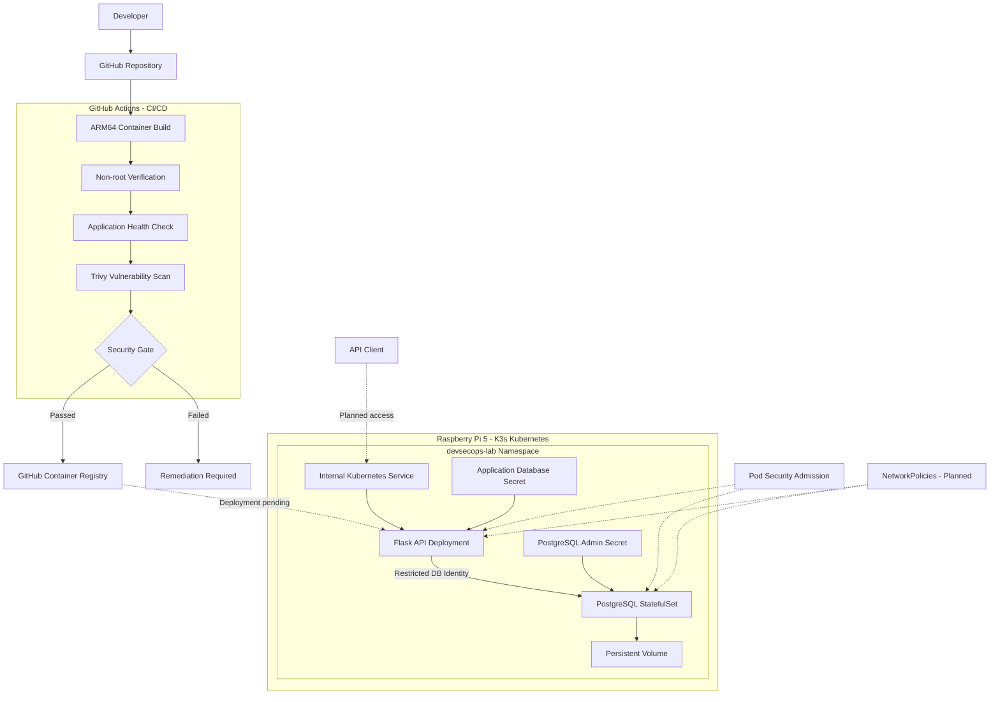
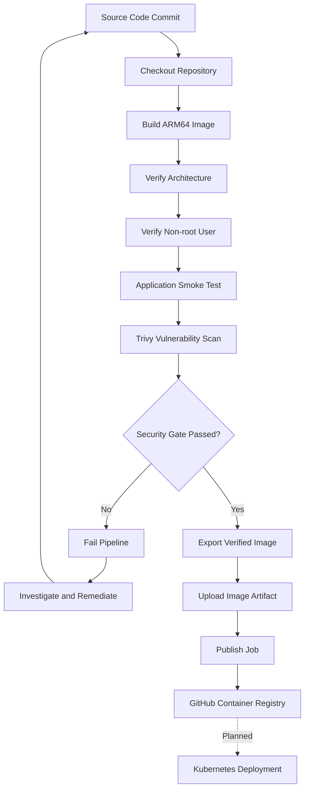
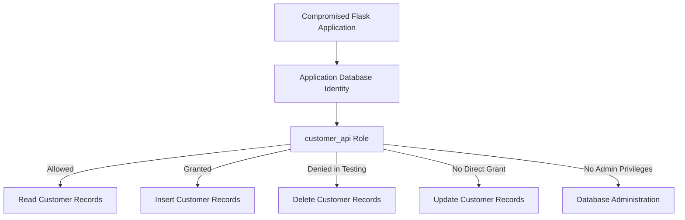

# Raspberry Pi DevSecOps Security Lab

[](https://github.com/YusTech123/pi-cloud-security-lab/actions/workflows/container-ci.yml)


## Securing a Cloud-Native Application: From Code to Runtime

A hands-on DevSecOps and cloud-native security project built using a Raspberry Pi 5, Kubernetes (K3s), Python Flask, PostgreSQL and GitHub Actions.

The objective is to demonstrate how a cloud-native application can be designed, deployed, secured and assessed throughout its software development lifecycle.

Rather than simply deploying security tools, this project focuses on understanding realistic attack paths, implementing appropriate security controls, validating their effectiveness and reducing the potential blast radius of a compromise.

**Project status:** In progress — Application integration, containerisation, CI/CD security scanning and container registry publishing completed.

---

## Table of Contents

- [Project Objectives](#project-objectives)
- [Architecture](#architecture)
- [Technology Stack](#technology-stack)
- [Repository Structure](#repository-structure)
- [Implementation Progress](#implementation-progress)
- [CI/CD and Software Supply Chain](#cicd-and-software-supply-chain)
- [Security Controls and Evidence](#security-controls-and-evidence)
- [Vulnerability Detection and Remediation](#vulnerability-detection-and-remediation)
- [Identity and Blast Radius](#identity-and-blast-radius)
- [The 4Cs of Cloud-Native Security](#the-4cs-of-cloud-native-security)
- [Security Assurance](#security-assurance)
- [Residual Risks and Limitations](#residual-risks-and-limitations)
- [Local Development and Verification](#local-development-and-verification)
- [Project Roadmap](#project-roadmap)

---

## Project Objectives

- Design a cloud-native application architecture.
- Develop and containerise a Python REST API.
- Deploy application infrastructure using Kubernetes.
- Implement security controls across the software development lifecycle.
- Identify realistic attack paths and assess their potential impact.
- Apply least-privilege principles to application and infrastructure identities.
- Automate container security checks within CI/CD.
- Demonstrate security control effectiveness through practical testing.
- Assess residual risks and prioritise remediation.
- Document findings using recognised security frameworks.

---

## Architecture

The application consists of a Python Flask REST API backed by a PostgreSQL database.

GitHub provides source control, GitHub Actions handles container builds and security scanning, and GitHub Container Registry (GHCR) stores verified container images.

The Raspberry Pi acts as the local Kubernetes environment, providing a practical and cost-effective platform for implementing and testing cloud-native security controls.

### Target Architecture



### Current Architecture

- PostgreSQL is running inside the K3s cluster.
- Flask has been developed and tested on the Raspberry Pi host.
- Flask communicates with PostgreSQL through temporary Kubernetes port-forwarding during development.
- The Flask container image has been successfully built, tested and published to GHCR.
- Deployment of the Flask container into Kubernetes is the next milestone.

The API is not intentionally exposed to the public internet.

---

## Technology Stack

| Component | Technology |
|---|---|
| Hardware | Raspberry Pi 5 - 16 GB RAM |
| Operating System | Raspberry Pi OS - Debian 12 Bookworm |
| Kernel Architecture | ARM64 (aarch64) |
| Host Userspace | ARM 32-bit (armhf) |
| Container Orchestration | Kubernetes (K3s) |
| Kubernetes Version | v1.37.1+k3s1 |
| Container Runtime | containerd |
| Backend | Python Flask |
| Application Server | Gunicorn |
| Database | PostgreSQL 16 |
| Database Driver | Psycopg 3 |
| Containerisation | Docker |
| Container Architecture | Linux ARM64 |
| Persistent Storage | K3s Local Path Provisioner |
| Version Control | Git and GitHub |
| CI/CD | GitHub Actions |
| Container Registry | GitHub Container Registry (GHCR) |
| Vulnerability Scanning | Trivy |
| Security Policies | Kubernetes Pod Security Admission |
| Network Isolation | Kubernetes NetworkPolicies - planned |
| Runtime Detection | Planned |

---

## Repository Structure

```text
pi-cloud-security-lab/
├── .github/
│   └── workflows/
│       └── container-ci.yml
├── app/
│   └── main.py
├── db/
│   └── init.sql
├── k8s/
│   └── postgres.yaml
├── .dockerignore
├── .gitignore
├── Dockerfile
├── requirements.txt
└── README.md
```

Additional Kubernetes manifests, architecture documentation, threat models and security evidence will be added as the project progresses.

---

## Implementation Progress

### Phase 1 — Infrastructure Preparation

**Status: Completed**

- Configured the Raspberry Pi 5 development environment.
- Verified hardware, memory, storage and processor architecture.
- Enabled Linux memory cgroups.
- Installed K3s Kubernetes.
- Verified Kubernetes node readiness.
- Confirmed Kubernetes system workloads were operational.

#### Challenges Encountered

The Raspberry Pi initially had its memory cgroup controller disabled. This was resolved by updating the kernel boot parameters and rebooting the device.

The initial K3s installation also failed because the installer could not reach its release discovery endpoint.

The installation was completed by specifying a K3s release directly.

---

### Phase 2 — Kubernetes Security

**Status: Completed**

Created a dedicated application namespace:

`devsecops-lab`

Configured Kubernetes Pod Security Admission:

- Baseline policy enforcement.
- Restricted policy warnings.
- Restricted policy auditing.

#### Security Validation

Attempted to create a privileged container using Kubernetes server-side dry-run validation.

**Expected result:** Kubernetes rejects the privileged workload.

**Actual result:**

```text
Error from server (Forbidden):
violates PodSecurity "baseline:latest": privileged
```

**Conclusion:** The configured Baseline policy successfully rejected the tested privileged workload.

No privileged Pod was created during the test.

---

### Phase 3 — Flask REST API Development

**Status: Completed**

Developed a Python Flask customer management REST API.

The application initially used temporary in-memory customer records before being integrated with PostgreSQL.

#### API Endpoints

| Method | Endpoint | Description |
|---|---|---|
| GET | / | Application information |
| GET | /health | Application health check |
| GET | /customers | Retrieve all customers |
| GET | /customers/{id} | Retrieve an individual customer |

#### API Testing

| Endpoint | Expected Result | Actual Result |
|---|---|---|
| /health | HTTP 200 | Passed |
| /customers | HTTP 200 | Passed |
| /customers/1 | HTTP 200 | Passed |
| /customers/999 | HTTP 404 | Passed |

Only fictional customer records are used throughout this project.

---

### Phase 4 — PostgreSQL on Kubernetes

**Status: Completed**

Deployed PostgreSQL 16 using a Kubernetes StatefulSet.

Implemented:

- Internal headless Kubernetes Service.
- PersistentVolumeClaim requesting 2 GiB storage.
- Kubernetes Secret for database administrator credentials.
- Non-root container execution configuration.
- RuntimeDefault seccomp profile.
- Disabled privilege escalation.
- Dropped Linux capabilities.
- CPU and memory resource limits.
- Database readiness probe.

#### Verification Results

- PostgreSQL Pod running and ready.
- PersistentVolumeClaim successfully bound.
- Database accepting connections.
- Database connectivity verified using SQL queries.
- Customer database schema created.
- Fictional customer records inserted and verified.
- Duplicate record prevention verified.

The database uses persistent local storage rather than the container's ephemeral filesystem.

---

### Phase 5 — Database Identity and Application Integration

**Status: Completed**

Integrated the Flask REST API with PostgreSQL using Psycopg 3.

Implemented:

- Dedicated PostgreSQL application identity.
- Least-privilege database permissions.
- Environment-based database credentials.
- Parameterised SQL queries.
- Generic HTTP 503 responses for database errors.
- Persistent customer records.

The Flask application uses the `customer_api` database role rather than the PostgreSQL administrator account.

#### Database Permissions

| Permission | Application Account |
|---|---|
| Connect to customerdb | Granted |
| SELECT customer records | Granted |
| INSERT customer records | Granted |
| UPDATE customer records | Not granted |
| DELETE customer records | Not granted |
| Superuser privileges | Disabled |
| Create database | Disabled |
| Create roles | Disabled |

#### Security Validation

| Test | Result |
|---|---|
| SELECT customer records | Allowed |
| DELETE customer records | Denied |
| Independent database login | Successful |
| Python-to-PostgreSQL connection | Successful |
| Flask database-backed customer retrieval | Successful |
| Invalid customer ID handling | HTTP 404 |

The SELECT and DELETE tests were performed using PostgreSQL's `SET ROLE` functionality to verify authorisation.

A subsequent TCP connection using the application identity also succeeded. Password enforcement from a separate application Pod will be tested after Kubernetes deployment.

#### Technical Challenge

The initial installation of `psycopg[binary]` failed because a compatible binary dependency could not be resolved for the Raspberry Pi environment.

This was resolved by installing the PostgreSQL client library (`libpq5`) and using Psycopg's pure Python implementation.

---

### Phase 6 — Containerisation and Container Security

**Status: Completed**

Containerised the Flask application using Docker and Gunicorn.

The container image is built for Linux ARM64 using GitHub-hosted runners.

#### Container Security Configuration

- Python slim base image.
- Minimal system packages.
- Dedicated non-root user.
- Runtime user ID 10001.
- PostgreSQL client library.
- Python dependencies installed from a version-pinned requirements file.
- Unnecessary packaging tools removed.
- `.dockerignore` configured to exclude local environments and sensitive files.
- Gunicorn used instead of the Flask development server.

#### Verification Results

- ARM64 image successfully built.
- Container architecture verified.
- Non-root execution verified.
- Gunicorn successfully started.
- Container health endpoint returned HTTP 200.
- Trivy vulnerability scanning completed.

The container health test verifies application startup, not end-to-end database connectivity.

---

### Phase 7 — CI/CD and Container Registry

**Status: Completed**

Implemented an automated GitHub Actions pipeline to build, test, scan and publish the container image.

The pipeline is separated into two jobs:

1. `container-security`
2. `publish-image`

The publishing job depends on successful completion of the container security job.

The verified image is transferred between jobs as an artifact rather than being rebuilt before publishing.

#### Verification Results

- ARM64 container build successful.
- Container security checks passed.
- Verified image artifact created.
- GitHub Container Registry authentication successful.
- Container image published successfully.

The image is published using the Git commit SHA as its tag.

**Next milestone:** Deploy the verified container image into Kubernetes using its immutable digest.

---

## CI/CD and Software Supply Chain

The CI/CD pipeline implements automated security checks before allowing a container image to be published.



### Pipeline Security Controls

| Control | Security Purpose |
|---|---|
| Read-only build token | Reduce CI/CD permissions |
| Separate publishing job | Restrict registry write access |
| Automated container scanning | Detect vulnerable image components |
| Security gate | Block images that violate the vulnerability threshold |
| Non-root verification | Validate container runtime identity |
| Application smoke test | Identify application startup failures |
| Image artifact transfer | Publish the image that was actually tested |
| Git commit SHA tagging | Associate images with source code revisions |
| Image digest | Support immutable deployments |
| GitHub-generated token | Avoid long-lived registry credentials |

### Vulnerability Policy

The current Trivy security gate blocks fixable HIGH and CRITICAL vulnerabilities.

Unfixed vulnerabilities are excluded from the blocking criteria and require separate assessment.

A successful pipeline does not guarantee that the image is free from all vulnerabilities.

### Container Registry

```text
ghcr.io/yustech123/pi-cloud-security-lab
```

Published images are tagged using their corresponding Git commit SHA.

Kubernetes deployments will reference the immutable image digest rather than a mutable tag.

[View GitHub Actions](https://github.com/YusTech123/pi-cloud-security-lab/actions)

---

## Security Controls and Evidence

| Security Control | Risk Addressed | Evidence / Status |
|---|---|---|
| Pod Security Admission | Privileged workload deployment | Verified - privileged Pod rejected |
| Non-root API container | Excessive container privileges | Verified - UID 10001 |
| Non-root PostgreSQL | Excessive database container privileges | Configured |
| Dropped Linux capabilities | Unnecessary system privileges | Configured for PostgreSQL |
| Seccomp | Unrestricted system calls | RuntimeDefault configured |
| Privilege escalation restrictions | Container privilege escalation | Configured for PostgreSQL |
| Kubernetes Secrets | Hardcoded database credentials | Configured for PostgreSQL |
| Database least privilege | Excessive database permissions | SELECT allowed, DELETE denied |
| Parameterised SQL queries | SQL injection | Implemented |
| Environment-based credentials | Hardcoded application passwords | Implemented |
| Generic error responses | Exposure of internal application details | Implemented; failure testing pending |
| Resource limits | Uncontrolled resource consumption | Configured for PostgreSQL |
| Persistent storage | Data loss during Pod replacement | PVC bound; recovery testing pending |
| Container vulnerability scanning | Vulnerable container components | Trivy gate verified |
| Vulnerability remediation | Known vulnerable dependencies | Two HIGH findings addressed; rescan passed |
| CI/CD security gate | Publishing vulnerable builds | Verified |
| Pipeline least privilege | Excessive CI/CD permissions | Separate build and publishing jobs |
| Immutable image deployment | Image substitution | Digest available; deployment pending |
| NetworkPolicies | Unnecessary network reachability | Planned |
| Kubernetes workload identity | Excessive workload permissions | Planned |
| API authentication | Unauthorised API access | Planned |
| API authorisation | Unauthorised access to customer records | Planned |
| SAST, SCA and secrets scanning | Vulnerable code and exposed credentials | Planned |
| Runtime detection | Undetected malicious activity | Planned |

These controls form part of a defence-in-depth strategy.

Additional testing will assess control effectiveness, potential bypasses and residual risks.

---

## Vulnerability Detection and Remediation

### Initial Security Finding

During the initial CI/CD pipeline execution, Trivy detected two HIGH-severity vulnerabilities within the container image.

| Vulnerability | Affected Component | Installed Version | Fixed Version |
|---|---|---|---|
| CVE-2026-23949 | jaraco.context | 5.3.0 | 6.1.0 |
| CVE-2026-24049 | wheel | 0.45.1 | 0.46.2 |

The affected components were associated with Python packaging dependencies.

The vulnerability scanner returned exit code 1, causing the pipeline to fail.

### Risk Assessment

The vulnerabilities involved malicious archive or package processing.

The Flask application does not currently process uploaded tar archives or Python wheel files during normal runtime.

This reduces the apparent direct runtime exposure of these vulnerabilities. However, retaining unnecessary vulnerable components increases the container's potential attack surface.

Removing the unnecessary components was considered an appropriate remediation because they were not required for normal application operation.

### Remediation

Updated the Dockerfile to remove unnecessary Python packaging tools after installing application dependencies.

```dockerfile
RUN python -m pip install --no-cache-dir -r requirements.txt \
    && python -m pip uninstall -y setuptools wheel \
    && python -m pip check
```

This reduced the runtime attack surface while retaining the dependencies needed by the application.

### Remediation Verification

| Security Check | Initial Build | Remediated Build |
|---|---|---|
| ARM64 container build | Passed | Passed |
| Non-root execution | Passed | Passed |
| Application health check | Passed | Passed |
| Trivy vulnerability scan | Failed | Passed |
| Overall pipeline | Failed | Passed |

### Security Outcome

The initial pipeline correctly identified vulnerabilities and failed its security checks.

Following remediation, the container was rebuilt, tested and rescanned successfully.

The verified image was subsequently published to GHCR through the updated CI/CD pipeline.

This demonstrates a practical vulnerability management lifecycle:

```text
Detect → Assess → Remediate → Verify → Publish
```

The successful rescan confirms compliance with the configured security gate, rather than the complete absence of vulnerabilities.

### Vulnerability References

- [CVE-2026-23949](https://nvd.nist.gov/vuln/detail/CVE-2026-23949)
- [CVE-2026-24049](https://nvd.nist.gov/vuln/detail/CVE-2026-24049)

---

## Identity and Blast Radius

Identity is an important factor when assessing the potential impact of a compromised application.

The application uses a dedicated PostgreSQL identity rather than administrator credentials.



### Security Benefit

Restricting the application identity reduces the potential impact of a compromise by limiting the database operations available to an attacker.

### Residual Risk

An attacker who compromises the Flask application could still read customer records using the application's legitimate permissions.

The account also has INSERT permissions, which introduces a potential data integrity risk.

Because the current API only implements GET endpoints, the necessity of INSERT permissions will be reviewed before release.

Least privilege therefore reduces the blast radius of a compromise but does not eliminate the underlying risk.

---

## The 4Cs of Cloud-Native Security

This project follows the four layers of cloud-native security.

| Layer | Implemented Controls | Remaining Work |
|---|---|---|
| Code | Parameterised SQL queries, environment-based credentials, generic error handling | SAST, SCA, secrets scanning, authentication and authorisation |
| Container | Non-root execution, minimal base image, dependency remediation, Trivy scanning | Image signing, SBOM generation and additional runtime hardening |
| Cluster | Pod Security Admission, Kubernetes Secrets, PostgreSQL security contexts | API deployment, RBAC, NetworkPolicies and runtime detection |
| Cloud | GitHub-hosted CI/CD, restricted pipeline tokens, container registry | Production cloud IAM, logging, encryption and network architecture assessment |

The Raspberry Pi provides a local environment for demonstrating Kubernetes security.

Public cloud services such as Azure Kubernetes Service, managed databases, Key Vault and cloud-native identity services are not currently deployed.

Production cloud controls will be considered as part of the architecture assessment.

---

## Security Assurance

Security assurance focuses on demonstrating that controls are effective, rather than simply confirming that they exist.

| Control | Expected Behaviour | Evidence | Proposed Metric |
|---|---|---|---|
| Pod Security Admission | Reject privileged workloads | Forbidden admission response | Percentage of prohibited workloads rejected |
| Database least privilege | Deny unauthorised database operations | SELECT allowed; DELETE denied | Percentage of permission tests passed |
| Non-root execution | Application runs without root privileges | UID 10001 verified in CI | Percentage of release images running as non-root |
| Vulnerability scanning | Block fixable HIGH and CRITICAL vulnerabilities | Failed and successful Trivy runs | Percentage of release images scanned |
| CI/CD publishing gate | Publish only after successful security checks | Successful dependent publishing job | Percentage of releases passing required checks |

These metrics represent proposed ongoing assurance measurements.

Further work will introduce repeatable security tests, remediation ownership and exception-handling procedures.

---

## Residual Risks and Limitations

This project is a controlled learning environment rather than a production-ready deployment.

| Risk | Current Assessment | Planned Mitigation |
|---|---|---|
| Unauthorised API access | Customer endpoints lack authentication | Implement API authentication and authorisation |
| Excessive network reachability | Network isolation not yet enforced | Kubernetes NetworkPolicies |
| Compromised application identity | Application can read customer data | Restrict permissions and introduce additional access controls |
| Excessive database permissions | INSERT granted but not currently required | Review and reduce database grants |
| Credential exposure | Kubernetes Secrets are not a complete secrets-management solution | Assess encryption at rest and secret access |
| Vulnerable dependencies | Image scan cannot identify every vulnerability | SCA, regular rescanning and remediation |
| Software supply chain compromise | Third-party actions and base images use version tags | Immutable action and image references, provenance and signing |
| Undetected runtime attacks | Runtime detection not yet implemented | Logging, monitoring and detection tests |
| Storage failure | Database uses single-node local storage | Backup and recovery testing |
| Availability | Single-node Kubernetes architecture | Document production high-availability requirements |

Risk prioritisation will consider:

**Vulnerability + Exposure + Reachability + Identity + Sensitive Data + Blast Radius**

Scanner severity alone will not determine remediation priority.

---

## Local Development and Verification

### Clone the Repository

```bash
git clone https://github.com/YusTech123/pi-cloud-security-lab.git

cd pi-cloud-security-lab
```

### Prepare the Python Environment

On Debian-based systems:

```bash
sudo apt update

sudo apt install -y python3-venv libpq5

python3 -m venv .venv

source .venv/bin/activate

python -m pip install -r requirements.txt
```

### Check Kubernetes Resources

```bash
sudo kubectl get nodes

sudo kubectl get pods -n devsecops-lab

sudo kubectl get pvc -n devsecops-lab

sudo kubectl get svc -n devsecops-lab
```

### Verify PostgreSQL

```bash
sudo kubectl exec -n devsecops-lab postgres-0 -- \
  pg_isready -U postgres -d customerdb
```

```bash
sudo kubectl exec -n devsecops-lab postgres-0 -- \
  psql -U postgres -d customerdb \
  -c "SELECT id, name, email FROM public.customers;"
```

### Forward PostgreSQL for Local Development

In a separate terminal:

```bash
sudo kubectl port-forward \
  -n devsecops-lab \
  --address 127.0.0.1 \
  pod/postgres-0 5433:5432
```

These commands assume PostgreSQL, the customer schema and the application database role have already been configured.

### Run the Flask API

```bash
source .venv/bin/activate

read -rs -p "Database password: " DB_PASSWORD
echo
export DB_PASSWORD

python app/main.py
```

After stopping Flask, clear the password variable:

```bash
unset DB_PASSWORD
```

### Test API Endpoints

```bash
curl -i http://127.0.0.1:5000/health

curl -i http://127.0.0.1:5000/customers

curl -i http://127.0.0.1:5000/customers/1

curl -i http://127.0.0.1:5000/customers/999
```

### Security Considerations

- Never commit database credentials.
- Never commit Kubernetes Secret values.
- Never commit private SSH keys or Kubernetes credentials.
- Only use fictional customer records.
- Keep unauthenticated application endpoints restricted to the lab environment.

---

## Project Roadmap

### Infrastructure and Application

- [x] Configure Raspberry Pi 5.
- [x] Enable Linux memory cgroups.
- [x] Install K3s Kubernetes.
- [x] Verify Kubernetes cluster health.
- [x] Create dedicated application namespace.
- [x] Develop Flask REST API.
- [x] Configure GitHub repository.
- [x] Deploy PostgreSQL StatefulSet.
- [x] Configure persistent storage.
- [x] Create and verify customer database schema.
- [x] Integrate Flask with PostgreSQL.
- [x] Containerise Flask using Docker and Gunicorn.
- [ ] Deploy Flask container into Kubernetes.
- [ ] Verify end-to-end Kubernetes application connectivity.

### Security Implementation

- [x] Configure Pod Security Admission.
- [x] Verify privileged Pod rejection.
- [x] Implement least-privilege database access.
- [x] Verify restricted database permissions.
- [x] Implement parameterised SQL queries.
- [x] Implement environment-based credentials.
- [x] Configure PostgreSQL container security context.
- [x] Verify non-root API container execution.
- [x] Configure GitHub Actions CI pipeline.
- [x] Implement Trivy container scanning.
- [x] Remediate identified HIGH vulnerabilities.
- [x] Verify vulnerability remediation.
- [x] Separate build and publishing permissions.
- [x] Publish verified container image to GHCR.
- [ ] Deploy application using an immutable image digest.
- [ ] Enforce Restricted Pod Security Standards.
- [ ] Implement Kubernetes NetworkPolicies.
- [ ] Configure dedicated Kubernetes workload identities.
- [ ] Disable unnecessary service account token mounting.
- [ ] Implement API authentication and authorisation.
- [ ] Implement additional API input validation.
- [ ] Implement SAST, SCA and secrets scanning.
- [ ] Harden the software supply chain.
- [ ] Implement runtime monitoring and detection.
- [ ] Perform database backup and recovery testing.

### Security Assurance and Documentation

- [x] Verify privileged container rejection.
- [x] Verify database least-privilege enforcement.
- [x] Verify container runtime identity.
- [x] Verify vulnerability detection and remediation.
- [x] Verify CI/CD security gate.
- [ ] Create detailed threat model covering five scenarios.
- [ ] Diagram a complete attack path.
- [ ] Perform realistic attack-path testing.
- [ ] Assess security control effectiveness.
- [ ] Document risk prioritisation and residual risk.
- [ ] Map controls to NIST SSDF and OWASP frameworks.
- [ ] Create security evidence documentation.
- [ ] Publish complete technical article on Medium.

---

## Framework Mapping

The project will be mapped against recognised security frameworks, including:

- [NIST Secure Software Development Framework (SSDF)](https://csrc.nist.gov/projects/ssdf)
- [OWASP Software Assurance Maturity Model (SAMM)](https://owaspsamm.org/)
- [OWASP DevSecOps Maturity Model (DSOMM)](https://dsomm.owasp.org/)
- [OWASP API Security Top 10](https://owasp.org/API-Security/)

The objective is to demonstrate how individual security controls contribute to a repeatable and measurable security programme.

Detailed framework mapping will be completed alongside the final security assessment.

---

## Key Lessons Learned

- A healthy Kubernetes cluster is not necessarily a secure Kubernetes cluster.
- Security controls should be tested rather than assumed to work.
- Least privilege reduces the potential impact of compromised identities.
- Container images can contain vulnerable dependencies unrelated to application functionality.
- Removing unnecessary software can reduce the attack surface.
- Security scanning should influence deployment decisions.
- Vulnerability severity must be assessed alongside architectural context.
- Passing a security scan does not mean an application is completely secure.
- Security is a continuous process throughout the application lifecycle.

---

## Project Documentation

A complete technical article will be published on Medium, covering:

- Architecture and security design.
- Threat modelling and realistic attack paths.
- Kubernetes and container security.
- Identity and blast-radius analysis.
- CI/CD and software supply chain security.
- Vulnerability remediation.
- API and database security.
- Runtime detection and response.
- Security assurance and residual risk.

**Medium article:** Coming soon.

---

## Author

**Yusuf M.**

DevOps Engineer | Cloud Security | DevSecOps | Kubernetes | Infrastructure as Code

[GitHub Profile](https://github.com/YusTech123)

[Linkedin Profile](https://www.linkedin.com/in/yusuf-m-tech/)

---

## Disclaimer

This project is intended for educational purposes and security experimentation within an authorised lab environment.

All customer records are fictional. No production systems or real customer data are used.
